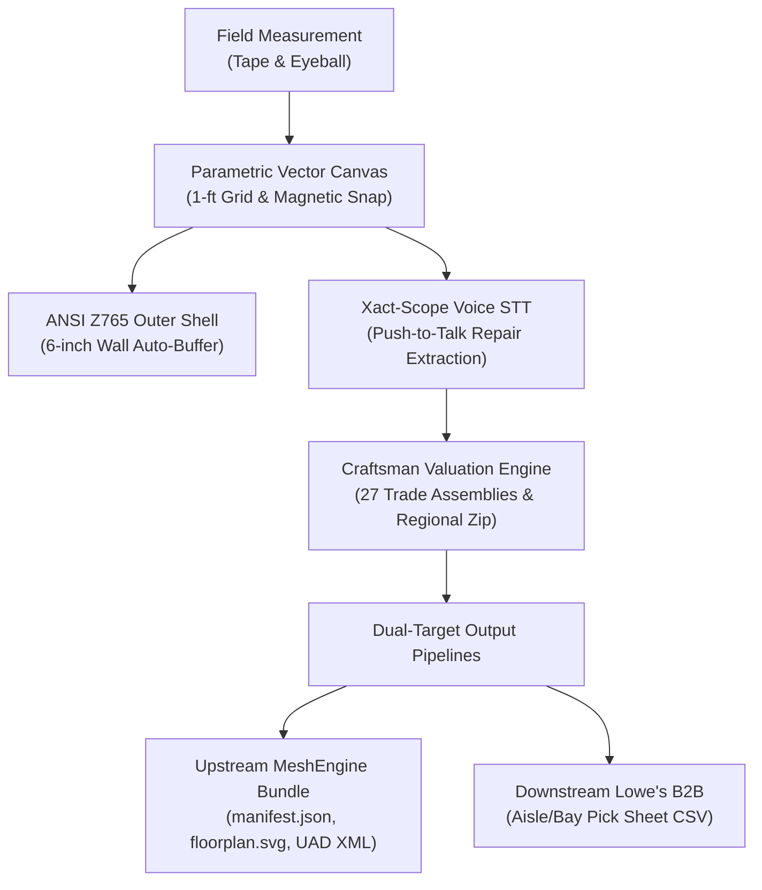
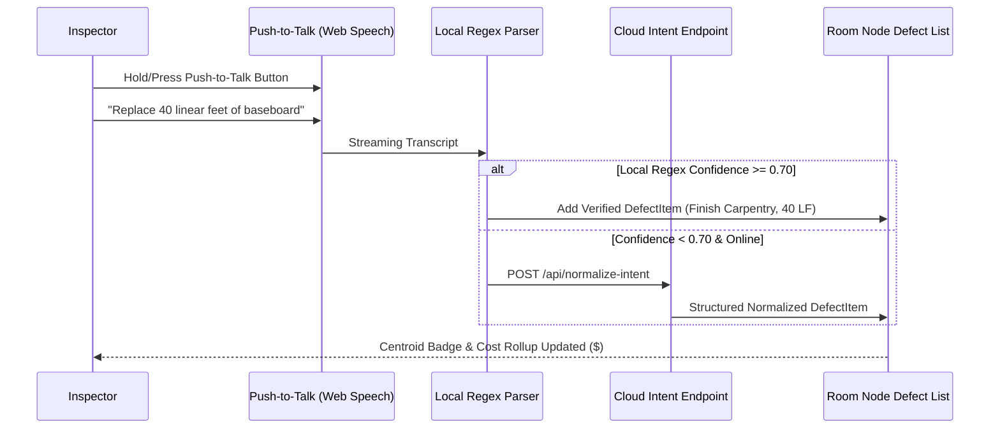
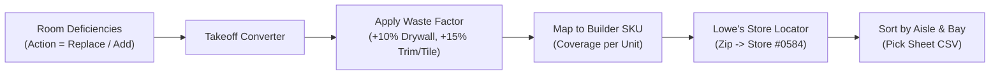

# DataMesh Sprocket Core System | Field User Manual & Operations Guide

> **Version:** 1.0.0  
> **Target Audience:** Field Inspectors, Appraisers, Cost Estimators, and General Contractors  
> **Ecosystem:** Standalone Field Client & Ingestion Provider for MeshEngine / DataMesh Labs  

---

## 1. Executive Summary & Field Philosophy

**DataMesh Sprocket** is a touch-friendly, offline-first residential inspection, parametric floor plan modeling, voice-guided deficiency scoping, and renovation costing application.



### Core Design Principles:
- **Zero Photogrammetry/SLAM Friction:** Built specifically for standard measuring tape and visual inspection (**Tape & Eyeball**). Eliminates LiDAR drift, battery drain, and calibration delays.
- **Parametric 1-Foot Grid:** Rooms snap together on standard 12-inch boundaries, with edge-to-edge magnetic guide snapping.
- **ANSI Z765 Exterior Wall Auto-Buffer:** Eliminates exterior measuring hazards (e.g. steep slopes, brambles, brick offsets) by computing interior perimeter hulls and automatically buffering exterior walls by 6 inches ($0.5\text{ ft}$).
- **Push-to-Talk Xact-Scope:** Voice STT bound directly to the active room context with offline regex entity extraction.
- **Deterministic Cost Valuation:** Craftsman National Building Cost standards adjusted by regional zip-code cost modifiers (Prairie Village 66208 baseline: Mat $-1.0\%$, Lab $+13.0\%$, Equip $0.0\%$).
- **Dual Downstream Distribution:** Delivers both an upstream drop package for appraisal ingestion (MeshEngine) and real-world builder procurement sheets for store routing (Lowe's B2B).

---

## 2. Interface Overview

The interface is structured for single-hand or tablet stylus operation in the field:

```
+-----------------------------------------------------------------------------------------------+
| [Logo] DataMesh Sprocket  | 7550 Windsor St, Prairie Village, KS 66208   [Valuation] [Lowe's] [Export]|
+-----------------------------------------------------------------------------------------------+
|                                                                                               |
|                                                                                               |
|                                    INTERACTIVE SVG CANVAS                                     |
|                               (Pinch / Pan / 1-ft Snapping)                                   |
|                                                                                               |
|                                                                                               |
|  [ANSI GLA: 2,250 SF]                                                                         |
+-----------------------------------------------------------------------------------------------+
|  [ Level Selector: First Floor | Second Floor | Basement ]                                     |
|  [ Add Room Palette: Living Room | Kitchen | Bed | Bath | Rec Room | Custom ]                 |
+-----------------------------------------------------------------------------------------------+
```

### Key UI Sections:
1. **Header Bar:**
   - **Project Metadata:** Street, City, State, and Zip Code.
   - **Live Metric Tickers:** Gross Living Area (GLA), Total Room count, Direct Cost Subtotal, Cost to Cure, Post-Renovation Replacement Cost New (RCN), and As-Is Valuation.
   - **Action Controls:** Craftsman Valuation Modal, Lowe's B2B Order Modal, and the single-click **MeshEngine Drop (.ZIP)** packager.
2. **Main Canvas Viewport:**
   - Vector SVG canvas featuring smooth `viewBox` zooming and panning.
   - Coordinate grids with 1-foot minor grid lines and 5-foot major grid lines.
   - Room blocks with centroid badges, wall openings (doors, windows, cased openings), and exterior ANSI Z765 hull boundaries.
3. **Bottom Floating Dock:**
   - **Floor Level Tabs:** Filter and organize rooms across `First Floor`, `Second Floor`, and `Basement`.
   - **Room Palette:** 1-click room template insertion (Living Room, Kitchen, Bedroom, Bathroom, Basement Rec Room, Custom Room).
4. **Room Inspection Drawer (Slide-Over):**
   - Opened immediately upon tapping any room block. Contains dimensions, ratings, push-to-talk voice recorder, deficiency checklist, and cardinal direction photo slots.

---

## 3. Parametric Vector Canvas & Floor Plan Drafting

### 3.1. Navigation & Viewport Controls
- **Panning:** Touch and drag with one or two fingers on the empty canvas, or click-and-drag with mouse/stylus.
- **Zooming:** Pinch with two fingers, scroll mouse wheel, or use the floating toolbar buttons (**+**, **-**, **Fit View**).
- **Grid Toggle:** Use the Grid button on the floating toolbar to show or hide the 1-foot grid.
- **ANSI Buffer Toggle:** Toggle the red dashed ANSI Z765 exterior shell overlay on or off.

### 3.2. Adding & Arranging Rooms
1. Select the target level in the bottom dock (`First Floor`, `Second Floor`, or `Basement`).
2. Tap any room template in the **Add Room Palette** (e.g. *Living Room (20'×16')*).
3. The new room will appear on the canvas automatically aligned to the nearest 1-foot grid boundary.
4. Drag the room body to place it. When dragging within **14 inches** of an adjacent room's wall:
   - **Magnetic Snapping** activates automatically.
   - Dashed magenta alignment guides indicate flush edges (Left, Right, Top, Bottom) or edge-to-edge docking.

### 3.3. Dynamic Resizing
When a room is tapped, it displays a cyan selection border with three interactive handles:
- **Right Edge Handle:** Drag horizontally to adjust `length_ft` in 1-foot (12-inch) increments.
- **Bottom Edge Handle:** Drag vertically to adjust `width_ft` in 1-foot increments.
- **Corner Circle Handle:** Drag diagonally to resize both dimensions simultaneously.

### 3.4. ANSI Z765 Outer Shell Auto-Buffer
> [!IMPORTANT]
> Real estate appraisal standards (ANSI Z765) mandate that Gross Living Area (GLA) must be measured from **exterior** finished surfaces. When measuring interiors (tape & eyeball), failing to account for wall thickness underestimates GLA by 5% to 8%.

Sprocket automatically computes the exterior perimeter hull of all above-grade rooms (`First Floor` + `Second Floor`) and applies an exact 6-inch exterior wall boundary buffer:
$$\text{Perimeter}_{\text{ft}} = 2 \times (\text{Hull Length}_{\text{ft}} + \text{Hull Width}_{\text{ft}})$$
$$\text{Buffer Area}_{\text{sqft}} = \text{Perimeter} \times 0.5\text{ ft} + 4 \times (0.5\text{ ft} \times 0.5\text{ ft})$$
$$\text{ANSI GLA} = \text{Interior Floor Area} + \text{Buffer Area}$$

---

## 4. Xact-Scope Voice Scoping & Deficiency Capture

Field scoping frequently occurs in noisy environments or low-connectivity basements. Sprocket pairs browser-native speech recognition with a 100% offline rule & regex parser.



### 4.1. Step-by-Step Voice Scoping
1. Tap a room block to open the **Room Inspection Drawer**.
2. Press the circular **Microphone Button** (button illuminates in red with a pulsing ring).
3. Clearly speak the repair task:
   > *"Replace 40 linear feet of baseboard"*
4. Tap the button again to stop recording.
5. The extracted intent is previewed in green with:
   - **Action:** `Replace`
   - **Quantity & Unit:** `40 LF`
   - **Trade Category:** `Finish Carpentry`
   - **Description:** `Baseboard`
   - **Confidence:** `95% match`
6. Tap **+ Add Spoken Line Item to Room** to confirm. The item immediately updates the room's Cost to Cure and project summary.

### 4.2. Voice Syntax Reference Table

| Spoken Phrase Example | Parsed Action | Parsed Qty | Unit | Trade Category |
| :--- | :--- | :--- | :--- | :--- |
| *"Replace 40 linear feet of baseboard"* | `Replace` | 40 | `LF` | Finish Carpentry |
| *"Remove 150 square feet of carpet"* | `Remove` | 150 | `SF` | Carpet, Flooring |
| *"Install 2 ea plumbing fixtures"* | `Add` | 2 | `EA` | Plumbing Fixtures |
| *"Fix 80 sf drywall ceiling"* | `Replace` | 80 | `SF` | Drywall |
| *"Paint 250 sq ft of interior walls"* | `Replace` | 250 | `SF` | Painting |
| *"Demo 30 linear feet of kitchen cabinets"* | `Remove` | 30 | `LF` | Cabinets |
| *"Add 1 ea pre-hung interior door"* | `Add` | 1 | `EA` | Doors & Windows |

> [!TIP]
> If your browser microphone permissions are blocked or you are testing without speech, tap any of the quick-action pills in the drawer under **Sample Voice Phrases** for instant 1-tap testing.

---

## 5. Room Inspection Drawer Features

### 5.1. Dimensions & Wall Surface Calculation
- **Length, Width, and Ceiling Height** inputs allow manual fine-tuning.
- Automatic surface deductions:
  - $\text{Gross Wall Area} = 2 \times (\text{Length} + \text{Width}) \times \text{Height}$
  - $\text{Net Wall Area} = \text{Gross Wall Area} - \sum (\text{Opening Width} \times \text{Opening Height})$

### 5.2. Wall Openings Manager
To attach doors or windows to a room:
1. Tap **Add Opening** in the drawer.
2. Select **Type** (`Door`, `Window`, `Cased Opening`).
3. Select **Wall Side** (`Top`, `Bottom`, `Left`, `Right`).
4. Enter Width, Height, and Offset from the corner in inches.
5. Tap **Attach Opening**. The opening renders on the canvas with correct visual symbols (door swing arc, window sill line) and automatically deducts from net wall paint/drywall area.

### 5.3. Cardinal Photos with Compass Azimuth
Capture standardized photos for appraisal compliance:
- **North (0°)**, **East (90°)**, **South (180°)**, and **West (270°)** plus **Defect Photo**.
- Tapping **Capture** saves the image with an embedded orientation watermark and azimuth tag into IndexedDB for export into the MISMO UAD bundle.

---

## 6. Craftsman Valuation Engine & Regional Cost Adjustments

Sprocket runs on a deterministic Cost Approach model backed by the National Building Cost Manual standards.

### 6.1. Regional Multiplier Formula
Every trade direct cost is calculated using zip-code specific modifiers:
$$\text{Trade Direct Cost} = \left(\text{Base Mat} \times (1 + \text{MatMod})\right) + \left(\text{Base Lab} \times (1 + \text{LabMod})\right) + \left(\text{Base Equip} \times (1 + \text{EquipMod})\right)$$

**Prairie Village, KS (66208) Cost Index:**
- **Material Modifier:** $-1.0\%$ ($-0.01$)
- **Labor Modifier:** $+13.0\%$ ($+0.13$)
- **Equipment Modifier:** $0.0\%$ ($0.00$)

### 6.2. 3-Way Valuation Matrix
In the **Craftsman Valuation Modal**, the system presents a three-way financial comparison:
1. **As-Is Valuation Basis:** The appraised value of the property in its current physical state prior to repairs.
2. **Total Cost to Cure:** The sum of all itemized deficiencies, deferred maintenance, and incomplete trade scopes ($\sum \text{Trade Direct Cost} \times \text{Deficiency \%}$).
3. **Post-Renovation Value (Replacement Cost New / RCN):** The total replacement value once all repairs and finishes are completed:
   $$\text{Total Project Cost} = \text{Direct Costs} + \text{Indirect Costs (12\%)} + \text{Contractor Incentive (15\%)}$$

---

## 7. Lowe's B2B Pro Procurement Integration

The procurement engine converts inspection deficiency takeoffs into contractor purchase orders.



### 7.1. Industry Waste Factors
- **Drywall & Insulation:** $+10\%$ allowance.
- **Baseboards, Trim, & Moldings:** $+15\%$ allowance.
- **Tile, Hardwood, & Flooring:** $+15\%$ allowance.
- **Fixtures & Appliances:** $+0\%$ allowance.

### 7.2. In-Store Routing Pick Sheet
Line items are sorted sequentially by **Aisle** then **Bay** (e.g. *Aisle 08 / Bay 06* $\to$ *Aisle 12 / Bay 04* $\to$ *Aisle 19 / Bay 02* $\to$ *Aisle 31 / Bay 14*), saving contractors hours in the warehouse.
- Tap **Lowe's B2B Order** in the header.
- Review Contractor Pro pricing and savings compared to retail.
- Tap **Download Aisle/Bay Pick Sheet (CSV)** to print or load into store inventory systems.

---

## 8. Upstream MeshEngine Drop Bundle (.ZIP)

Tapping **MeshEngine Drop (.ZIP)** produces a flat-file package ready for ingestion into the DataMesh Labs ecosystem:

| File Name | Format | Purpose |
| :--- | :--- | :--- |
| `manifest.json` | JSON | Complete project tree, room dimensions, ANSI GLA, and Craftsman cost summaries. |
| `floorplan.svg` | Standalone SVG | Scalable vector graphic floor plan with wall openings, centroid badges, and ANSI buffer. |
| `uad_inspection_payload.xml` | XML (MISMO 3.6) | Fannie Mae / Freddie Mac UAD 3.6 appraisal inspection dataset with Q1-Q6 and C1-C6 ratings. |
| `lowes_materials_buy_sheet.csv` | CSV | Aisle/Bay grouped contractor materials takeoff list. |

---

## 9. Offline Field Installation (PWA Guide)

DataMesh Sprocket operates as an installable Progressive Web App (PWA). All project state, room nodes, and photos are saved locally in **IndexedDB** (`idb-keyval`), ensuring zero data loss if cell service drops.

### Installing on iPad / iPhone (Safari)
1. Open the Sprocket URL in **Safari**.
2. Tap the **Share** button (box with upward arrow).
3. Scroll down and tap **Add to Home Screen**.
4. The Sprocket icon will appear on your home screen and run full-screen without browser address bars.

### Installing on Android / Chrome / Windows Tablets
1. Open the Sprocket URL in **Google Chrome**.
2. Tap the browser menu (**⋮**) or the install icon in the address bar.
3. Select **Install DataMesh Sprocket**.

---

## 10. Troubleshooting & Field FAQ

> [!NOTE]
> **Q: What happens if I am in a rural metal building with no cell service?**  
> **A:** Sprocket runs 100% offline. The UI, vector canvas, IndexedDB storage, and local regex voice parser function without an internet connection. Once you regain connection, you can sync or download the MeshEngine bundle.

> [!NOTE]
> **Q: What if the local voice parser doesn't understand a phrase?**  
> **A:** You can tap **Manual Item** in the room drawer to select the Trade, Action, Qty, and Unit with two taps, or use the sample phrase buttons.

> [!NOTE]
> **Q: How do I change the property location for regional costing?**  
> **A:** Click **Craftsman Valuation** in the top bar. Use the **Preset Zip** dropdown to switch between Prairie Village (66208), Beverly Hills (90210), Dallas (75001), Chicago (60601), or Miami (33101). All room rollups update instantly.
